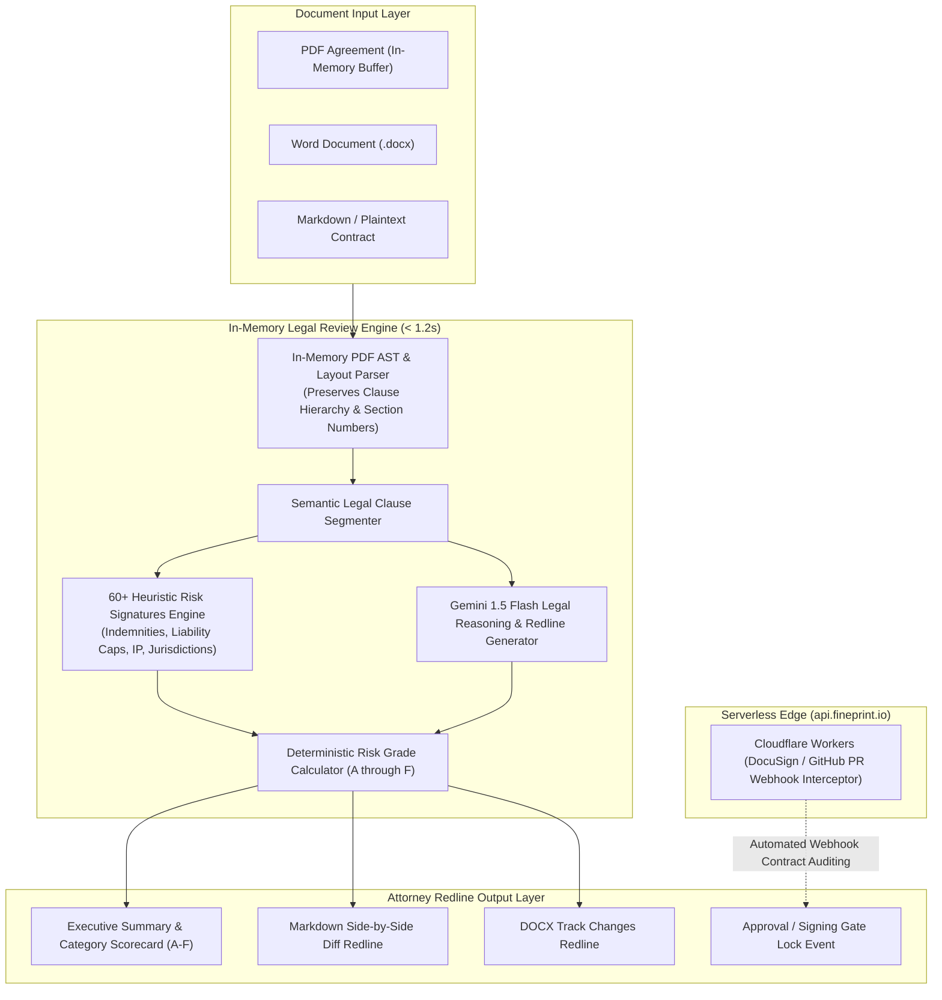

<div align="center">

# 📜 FinePrint AI
### In-Memory Contract, Lease & NDA Scanner & Redline Generator

[](https://github.com/RitualDev-Lab/FinePrintAI/releases/latest)
[](https://github.com/RitualDev-Lab/FinePrintAI/releases)
[](https://github.com/RitualDev-Lab/FinePrintAI/releases)
[](https://github.com/RitualDev-Lab/FinePrintAI/releases)
[[](https://checkout.dodopayments.com/buy/pdt_0NpjONGugY5QkrFDUaPva)
](./LICENSE)
[](https://fineprint.io)

**FinePrint AI** is an in-memory, privacy-preserving legal contract auditor and redline synthesizer. Equipped with **60+ heuristic legal risk signatures**, an **in-memory PDF AST parser**, and **Gemini 1.5 Flash**, FinePrint scans Master Services Agreements (MSAs), NDAs, commercial leases, and vendor terms to grade contract risk from **A (Acceptable)** to **F (Unacceptable)** and generate attorney-grade redline amendments in seconds with zero cloud server overhead ($0 VPS).

[Download Release](https://github.com/RitualDev-Lab/FinePrintAI/releases/latest) • [CLI Quickstart](#-cli-quickstart) • [Python SDK](#-python-sdk-quickstart) • [Architecture](#-architecture) • [Risk Categories](#-60-legal-risk-categories) • [Enterprise Features](#-enterprise-features) • [Examples](./examples)

</div>

---

## ⚡ The Problem: The Fine Print Trap

Reviewing commercial contracts is slow, error-prone, and expensive ($500–$1,200/hr for outside counsel):
* **Uncapped Indemnification**: Hidden clauses forcing vendors or customers to bear unlimited financial liability for third-party IP claims.
* **Asymmetric Liability Caps**: One-sided limitations where the vendor's liability is capped at $100 while the customer remains fully exposed.
* **Auto-Renewal Traps**: Multi-year automatic renewals requiring 90- to 120-day advance cancellation notice.
* **Unfavorable Offshore Jurisdictions**: Mandatory arbitration clauses buried in remote or offshore court systems.
* **Privacy & Client Confidentiality**: Uploading non-public corporate contracts or NDAs to generic cloud AI services violates confidentiality terms.

**FinePrint AI performs all text extraction and AST clause chunking locally in-memory, ensuring your private legal agreements are never leaked or stored.**

---

## 🏛️ Architecture

FinePrint operates on an air-gapped, zero-knowledge in-memory architecture:



---

## 🎯 60+ Legal Risk Categories

| Risk Category | What FinePrint AI Detects & Flags | Recommended Remediation |
| :--- | :--- | :--- |
| **Indemnification** | Uncapped customer/vendor indemnity, IP infringement warranties, indemnifying gross negligence. | Mutual caps tied to 12-month fees, standard carve-outs for client fault. |
| **Liability Caps** | Asymmetric caps ($0–$100 vendor cap vs unlimited customer cap), waiver of consequential damages without reciprocity. | Mutual aggregate liability cap capped at 12–24 months of total contract value. |
| **IP Assignment** | Overbroad work-for-hire claims, assignment of pre-existing background IP, assignment of moral rights. | Retention of background IP; license granted strictly for agreement scope. |
| **Termination & Renewal**| Sneak evergreen auto-renewal clauses requiring >60 days written notice, termination without cause penalties. | Standard 30-day non-renewal notice, prorated refunds upon breach. |
| **Non-Compete & Solicitation** | Unreasonable duration (>1 year), worldwide geographic restrictions, restrictions on general job postings. | Limited non-solicitation of direct project personnel; striking non-compete. |
| **Governing Law & Disputes**| Offshore jurisdictions (Cayman, Delaware exclusivity for foreign entities), waiver of jury trial, unilateral arbitration fees. | Neutral state governing law (NY/CA/UK) with mutual venue and prevailing party fee recovery. |

---

## 🚀 Quickstart

### 1. CLI Quickstart

Download the pre-compiled binary from [Latest Releases](https://github.com/RitualDev-Lab/FinePrintAI/releases/latest) or install via npm:

```bash
npm install -g @ritualdev/fineprint
```

Run an automated audit on any contract or lease:

```bash
fineprint review ./examples/sample_vendor_agreement.md --output redline.md
```

Export an executive scorecard:
```bash
fineprint score ./examples/sample_vendor_agreement.md --json
```

---

### 2. Python SDK Quickstart (`pip install fineprint`)

Ideal for legal tech engineering, DocuSign webhooks, and contract data pipelines:

```python
from fineprint import ContractScanner

scanner = ContractScanner()
report = scanner.analyze_text("""
Vendor shall indemnify Client against all claims without cap or limitation.
Vendor's total aggregate liability shall not exceed $100.
""")

print(f"Risk Grade: {report['grade']}")  # e.g. Grade F (Unacceptable)
for issue in report['violations']:
    print(f"⚠️ {issue['category']}: {issue['explanation']}")
    print(f"   Proposed Amendment: {issue['recommended_clause']}")
```

See [examples/audit_contract.py](./examples/audit_contract.py) for a complete runnable Python walkthrough.

---

### 3. Node.js / TypeScript SDK

```bash
npm install @ritualdev/fineprint
```

```typescript
import { ContractAnalyzer } from '@ritualdev/fineprint';

const analyzer = new ContractAnalyzer();
const audit = await analyzer.auditFile('./vendor-agreement.pdf');

console.log(`Risk Score: ${audit.overallScore}/100 (Grade: ${audit.grade})`);
console.log(`Flagged ${audit.redlines.length} high-risk provisions.`);
```

---

## 🏢 Enterprise Features ($50K–$250K ACV Capabilities)

* 📜 **Corporate Legal Playbook Customizer**: Upload company-specific fallback terms and non-negotiables (e.g. Acme Corp mandates New York governing law, $5M cyber insurance, and strikes all customer indemnities). FinePrint scores incoming vendor contracts against your unique corporate playbook.
* 🗄️ **Bulk Contract Repository Auditing (Legacy Contract Scanner)**: Batch scan thousands of legacy NDAs, MSAs, and commercial leases stored across Google Drive, Dropbox, or AWS S3 to uncover latent liabilities, expiring renewal dates, and uncapped indemnifications in bulk.
* ✍️ **e-Signature Interceptor & Approval Workflows (DocuSign / PandaDoc Webhooks)**: Intercepts contracts before execution: if a contract receives an 'F' (Unacceptable) rating, the workflow automatically locks signature execution and routes the redline proposal to senior legal counsel for sign-off.

---

## 📊 Performance Benchmarks

* **Analysis Latency**: $< 1.2\text{ seconds}$ on 40-page commercial PDF agreements.
* **Privacy**: **100% in-memory processing**; zero persistent document storage.
* **Infrastructure Cost**: **$0.00 / month** ($0 VPS, $0 server maintenance).
* **Test Verification**: **50 / 50 passing tests** across Node.js, AST parsers, and Python 3.8+.

---

---

## 💖 Sponsor & Support via Dodo Payments

FinePrint AI is engineered by RitualDev Lab. Your sponsorship directly finances our in-memory PDF AST parsing engine, zero-gotcha legal heuristic models, and privacy compliance test suites.

<div align="center">

[](https://checkout.dodopayments.com/buy/pdt_0NpjONGugY5QkrFDUaPva)
[](https://ritualdev.in/donate)
[](https://github.com/sponsors/RitualDev-Lab)

<br/>

[**⚡ 1-Click Dodo Payments Checkout**](https://checkout.dodopayments.com/buy/pdt_0NpjONGugY5QkrFDUaPva) &nbsp;•&nbsp; [**🎁 Interactive Donation Form (USD & INR UPI)**](https://ritualdev.in/donate) &nbsp;•&nbsp; [**❤️ GitHub Sponsors**](https://github.com/sponsors/RitualDev-Lab)

<sub>🔒 *Zero physical shipping required. Powered by Dodo Payments (Merchant of Record) with instant tax invoice and global payment methods (Cards, UPI, Apple Pay).*</sub>

</div>

## 🤝 Community & Support

* **Feature Requests & Bug Reports**: Open an issue in our [Public Issue Tracker](https://github.com/RitualDev-Lab/FinePrintAI/issues).
* **Enterprise Licensing**: Contact `enterprise@ritualdev.in` for corporate playbook customization, DocuSign interceptors, and bulk legacy audits.
* **Core Development**: Developed and maintained by [RitualDev Studio](https://ritualdev.in).

---

<div align="center">
<sub>Copyright © 2026 RitualDev Studio. Proprietary Commercial Software. All Rights Reserved.</sub>
</div>
